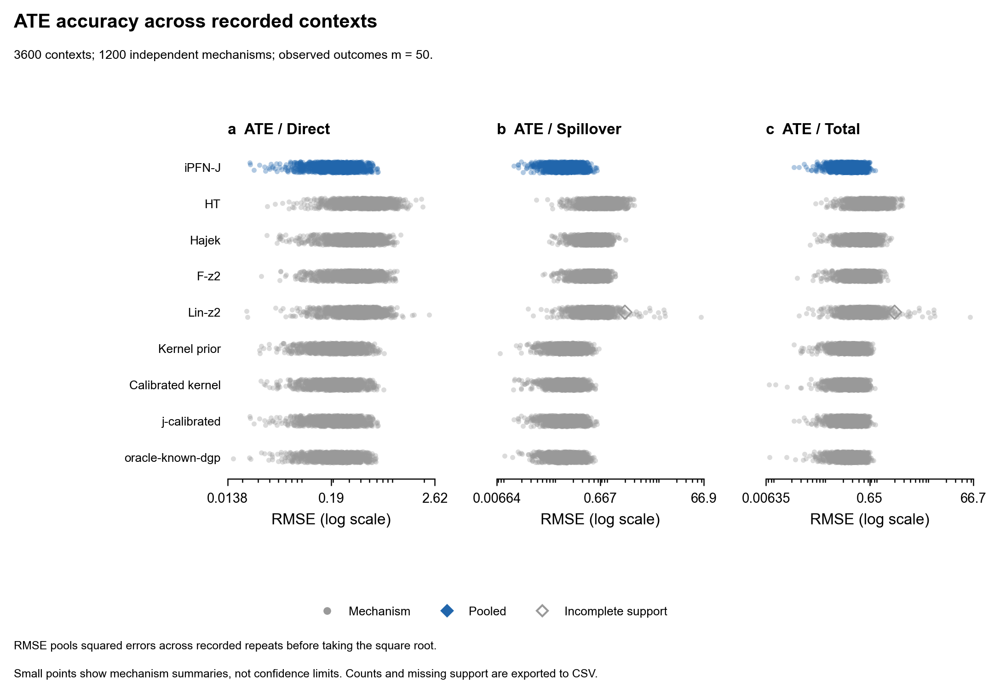

# 完整主测试：oracle、简单基线与冻结 J 同表

在已经完成且未更改的独立测试（六种 Configuration、每配置 200 个机制、3 repeats、观测 20/50/100）上，补充 **10800 个 oracle 预测**。原八种方法与新 oracle 合计九种方法的评测视图已用原 make_table.py 和 make_figures.py 实际生成表/图。

Oracle 知道真实共享隐藏表征、DGP 系数先验、噪声 SD；只用 observed_indices 对应的 factual design 与观测 Y 拟合。模拟真系数仅在独立 truth 重建检查使用，不传给拟合。1200 个机制的最大 truth 重建误差为 1.78e-15。这是模拟诊断参照，不是现实可部署方法，也不保证每个指标都最好。

观测数 50、六配置汇总：

| 方法 | 直接 RMSE | 溢出 RMSE | 总效应 RMSE | 直接/溢出/总效应覆盖 |
|---|---:|---:|---:|---|
| 原 J | 0.26164 | 0.18325 | 0.31884 | 96.31% / 94.89% / 96.42% |
| HT | 0.53521 | 0.88973 | 0.83960 | 原接口不支持区间 |
| 已知 DGP oracle | 0.25875 | 0.17960 | 0.31404 | 94.75% / 94.83% / 95.17% |

完整九方法的 bias、variance、RMSE、支持机制数和覆盖率见 tables/ate_m20.csv、ate_m50.csv、ate_m100.csv；包括 kernel-new 等 outcome 基线与校准 J。原 J / 校准 J 的点估计完全相同，校准机制独立于此测试。条件 bias 基于每机制 3 repeats，估计精度有限。



point_task_mean_sd.csv 另提供 J、HT、kernel-new、oracle 的 mu / ITE / ATE 任务均值与任务间 SD；HT 不支持的 mu/ITE 明确不评分。对于 mu/ITE，重复间“平均误差的方差”不等同于逐节点预测方差；不要混用。原方法的 interval / 点支持状态没有因拼接报告而更改。

## 数据保留与复现

protocol.json 保存原执行清单/评测 CSV 的哈希；verification.json 确认原结果未改且未选参数。evaluation_records.zip 只补新 oracle 的逐上下文 ATE 记录、四方法点误差记录、任务统计、truth 检查和协议；旧方法完整评测记录在 results/e12_calibration_v1/evaluation_records.zip。完整 oracle 预测数组留在本地 runs/e12_acceptance_oracle_v1/predictions。

这个新 run 是 **evaluation_view_only**：原方法的预测数组仍在源 calibration/test run，仅新 oracle 数组存于当前目录。不要把此视图当作全部预测文件集中存在的原始 run 去执行 evaluate.py。

先按 E12_INTERVAL_CALIBRATION.md 复现完整校准及测试，再从 sparse_j 运行（输出目录须不存在）：

```powershell
python complete_e12_oracle_table.py --input runs/e12_calibration_v1/test --output runs/e12_oracle_reproduction --workers 4
python make_table.py --input runs/e12_oracle_reproduction --output results/e12_oracle_reproduction/tables
python make_figures.py --input runs/e12_oracle_reproduction --output results/e12_oracle_reproduction/figures
```

最后两条生成原模板图表；逐任务指标由第一条生成于新 run 中。新机制偏移筛查的负面结果见相邻 e12_acceptance_v1，不能用这份参考分布主表代替偏移验收。

