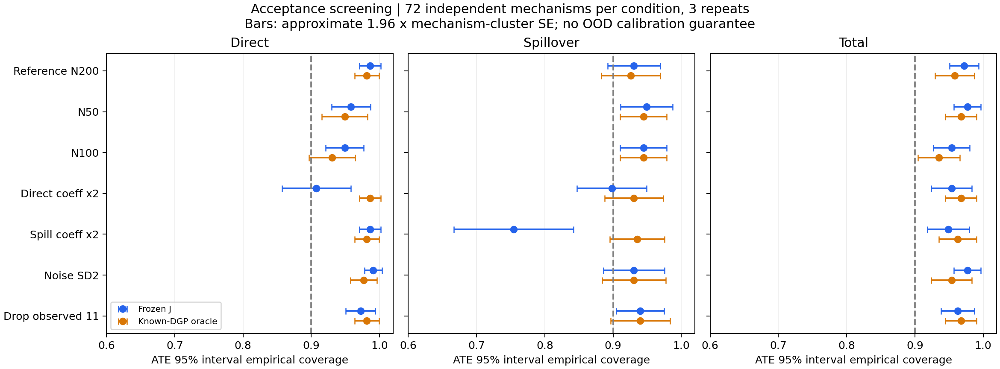

# E1.2 结构、机制与支持压力筛查

本轮保留冻结 J，不重训、不更改原校准系数。协议先登记，再运行 families 100–105、机制 4000–4011、重复 0–2。每条件 72 个独立机制 / 216 个上下文，每配置仅 12 个机制。共 **216 张图、1512 上下文、6048 方法记录**。这是相对 E1.2 参考分布的偏移筛查；训练分布缺少完整清单，因此不声称所有条件都是 checkpoint 的训练 OOD。

## 主要结果

| 条件 | J 直接覆盖 | J 溢出覆盖 | J 总效应覆盖 | oracle 溢出覆盖 |
|---|---:|---:|---:|---:|
| 参考 N=200 | 98.61% | 93.06% | 97.22% | 92.59% |
| N=50 | 95.83% | 94.91% | 97.69% | 94.44% |
| N=100 | 94.91% | 94.44% | 95.37% | 94.44% |
| 直接主系数 ×2 | 90.74% | **89.81%** | 95.37% | 93.06% |
| 溢出主系数 ×2 | 98.61% | **75.46%** | 94.91% | 93.52% |
| 噪声 SD=2 | 99.07% | 93.06% | 97.69% | 93.06% |
| 删除观测状态 (1,1) | 97.22% | 93.98% | 96.30% | 93.98% |

分母都是该条件下 216 个有效区间；没有把 3 次重复误称为独立机制。跨配置汇总会掩盖单配置差异，逐配置明细见 coverage_by_condition_family.csv，不能由上表推出每个配置都通过。图中误差条为 1.96 × 机制聚类标准误，是描述性近似，不是同时覆盖保证。



## 条件与目标

- 主实验固定 N=200，本轮扩展 N=50/100。固定“最多观察 50 个节点”，因而观察比例也随 N 改变；不是固定观察比例的纯 N 消融。
- 直接系数只将 beta[7:11] 加倍；溢出系数只将 beta[11:15]、beta[19:22] 加倍。并非所有直接/溢出效应整体精确乘二。
- N=200 的变体共用图、X、T、原观测掩码和标准噪声。不同 N 的图不同，不能称为同一图上的配对处理。
- 删除 (1,1) 是在原 50 个观测中去除该状态、没有补采，最终观察 30–48 个节点；不改变随机处理分配、真值或目标。
- 所有方法只能看到 factual 输入及选中节点 Y。Oracle 使用正确条件的系数先验、真实隐藏表征和噪声；真系数仅用于生成/核对 truth，不用于拟合。
- HT / kernel-new 为原接口点估计，没有可用的原 95% 区间。尤其删除状态后的观察选择具有信息性，原 HT 的均匀观测权重不再匹配；此压力条件的 HT 数值仅作未适配诊断，不能视作有效设计估计。

## 支持与接口检查

216/216 个删除状态上下文中 (1,1) 观测数为零；43200/43200 个该状态查询被本地 ordinary_plugin_values guard 拦截，所有实际观测状态查询均允许。总体处理分配下各状态仍有正概率，不能把经验空格等同于人口 positivity 失败或自动改成 NOT_IDENTIFIED。

本地适配器明确接收 target_id/status/node_ids/masks，把原 mu[N,4] 的 00,01,10,11 顺序转换为 mu[N,2,2]；NOT_IDENTIFIED 不调用模型且返回无 mu。此处 mask 只记录同一节点同一状态是否直接观测，非常保守，大部分反事实查询都会被拦截；**并未认证跨节点借用的经验支持**。这是一份有测试的接口提案，并未接入团队正式 identification 或决策入口。

## 如何解释覆盖失败

溢出主系数变化下 J 75.46% 对照 oracle 93.52%，提示冻结模型在该偏移下可能过度收缩或不能正确表达不确定性。Oracle 同时改变了可用表征知识与先验，不能仅凭这张表确定唯一原因。原参考分布的独立校准不提供这个偏移的保证。本轮未据此调参，也未将失败结果删除。

下一项模型改进若开展，应预先规定偏移范围，在新的开发/校准机制中比较收缩强度或独立区间校准，冻结后使用未见最终测试；同时评估区间宽度与点误差。不能在这些已看的 72 个机制上反复选择扩宽倍数再报告通过。

## 文件与复现

protocol.json 登记配置/源文件/模型哈希；verification.json 记录执行检查；graph_statistics.json 记录实际图统计；coverage_by_condition*.csv 记录区间；point_summary.csv / point_by_condition.csv 记录 mu、ITE、ATE 的任务指标；runtime_summary.csv 记录耗时。J/oracle 耗时包含区间，其他两方法是点估计，不作不加说明的速度排名。

screening_records.zip 保存原始 CSV、任务指标及协议。完整 factual / truth / prediction / support 数组保留在本地 runs/e12_acceptance_v1/shards，未放入审阅包。

从 sparse_j 目录，在已安装仓库依赖的 Python 环境运行（输出目录须不存在）：

```powershell
python run_e12_acceptance.py --output runs/e12_acceptance_reproduction --workers 4
python report_e12_acceptance.py --input runs/e12_acceptance_reproduction --output results/e12_acceptance_reproduction
python -m pytest -q
```

此补充覆盖图使用独立报告脚本；完整主表/图另按老师要求使用原 make_table.py / make_figures.py，见相邻 e12_acceptance_oracle_v1。

