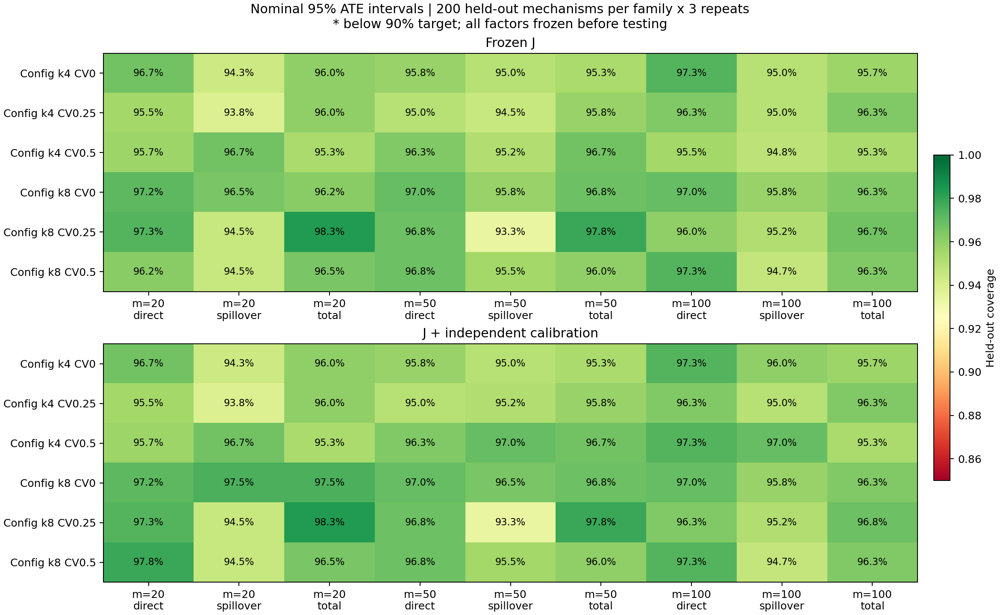
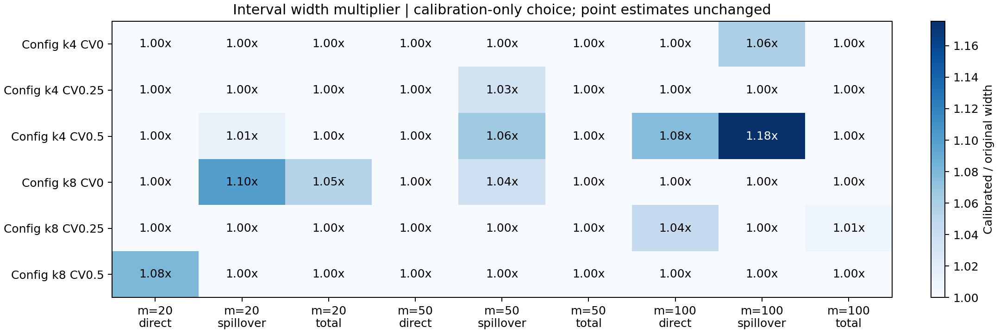

# E1.2 独立区间校准：完成结果与审阅说明

日期：2026-10-28。代码、测试、独立校准/测试实验及图表均已完成。本地改动未提交、未推送、未创建 PR，等待用户审阅。

**主要结论：新的独立测试中，原 J 与校准 J 均有 54/54 个“配置×观测预算×效应”组合达到 90%，最低均为 93.33%。校准为少数组合增加了覆盖余量，但原 J 已经达标，不能将全部达标归功于校准。**

## 实验执行及隔离

六种 Configuration 配置：平均度 4/8 × CV 0/0.25/0.5，节点数 200，观测预算 20/50/100。

- 每配置 100 个校准机制（ID 2000–2099），每个只取预定的 repeat 0；共 600 个独立机制、1,800 个上下文。
- 每配置 200 个新测试机制（ID 3000–3199），每个重复 3 次；共 1,200 个独立机制、10,800 个上下文。
- 同一测试上下文运行原 J、HT、Hajek、F-z2、Lin-z2、kernel-old、kernel-new，再加入 `j-calibrated`，共 86,400 条方法执行记录。
- 全部 54 个系数在首次生成测试数据前冻结。先完成 f103 先行测试，再按既定方案完成其余配置；未用测试结果重新选择参数。
- 原实验 ID 0–7 与此前复查 ID 1000–1099 均未用于本轮校准或测试。原来的 7 个失败组合继续保留在 v1 报告。

完整协议见 [protocol.json](protocol.json)，算法及复现命令见 [E12_INTERVAL_CALIBRATION.md](../../E12_INTERVAL_CALIBRATION.md)。底层 `LargeNetworkConfig` 保持原 `dev` 标识和种子机制，本扩展以不重叠的机制 ID 明确注册校准/测试角色；没有修改上游限制的 final split 协议。

## 校准如何工作

对每个配置、预算和效应，用独立校准机制计算“真 ATE 到原区间中心的距离 / 原半宽”，取 100 个分数中的第 96 个有序值，并将扩宽系数限制为至少 1。应用阶段只读取原区间及已冻结系数，不读取测试真值。

54 个组合中，42 个系数为 1，12 个扩宽；所有组合宽度比例的算术平均为 **1.01377**，最大为 **1.17570**。这是各组合等权的比例均值，不是将不同效应宽度混合后的单一百分比。12 个扩宽组合中有 11 个实测覆盖率增加，1 个在该批测试中命中数不变。

原 J 的所有 mu/ITE/ATE 点估计及支持标记均保留，故其 RMSE、bias、variance 与校准版本完全一致。新增方法的区间类型明确标为独立机制 split-conformal 校准区间，不冒充未经调整的后验可信区间。

## 覆盖率与区间宽度

以下按六种配置等权汇总，每行包含 1,200 个独立机制、3,600 个测试上下文。完整 54 个组合见 [coverage_comparison.csv](coverage_comparison.csv)。

| 观测数 | 效应 | 原 J 覆盖率 | 校准 J 覆盖率 | 原平均宽度 | 校准平均宽度 |
|---:|---|---:|---:|---:|---:|
| 20 | 直接 | 96.42% | 96.69% | 1.48248 | 1.50226 |
| 20 | 溢出 | 95.06% | 95.22% | 0.83814 | 0.85187 |
| 20 | 总效应 | 96.39% | 96.61% | 1.77831 | 1.79339 |
| 50 | 直接 | 96.31% | 96.31% | 1.08079 | 1.08079 |
| 50 | 溢出 | 94.89% | 95.42% | 0.71740 | 0.73482 |
| 50 | 总效应 | 96.42% | 96.42% | 1.32047 | 1.32047 |
| 100 | 直接 | 96.58% | 96.94% | 0.81625 | 0.83255 |
| 100 | 溢出 | 95.08% | 95.61% | 0.60711 | 0.63387 |
| 100 | 总效应 | 96.11% | 96.14% | 1.00768 | 1.00888 |

先行检查的 f103（平均度 8、CV=0）、观测数 50：溢出效应从 **95.83% → 96.50%**，平均宽度从 **0.60974 → 0.63265**，增加 **3.76%**；直接和总效应保持 **97.00% / 96.83%**。

最小覆盖率出现在 f104（平均度 8、CV=0.25）、观测数 50 的溢出效应：两个版本均为 **560/600=93.33%**，该格校准系数为 1。每机制只取 repeat 0 的另行检查中，两版本的 54 个组合也均超过 90%，最低 **184/200=92.00%**。

覆盖率的不确定性按机制整组重采样，重复仍保留在同一机制内，配对比较使用同一批重采样索引。CSV 包含 10,000 次 bootstrap 的描述性区间；这些不是全部 54 个组合的同时置信保证。有限测试中全部超过 90% 不等于任意未来机制或结构 OOD 都得到保证。

## 与 baseline 的点估计比较

观测数 50、六种配置汇总的 ATE RMSE 如下。J 与校准 J 的点估计逐数组相同，表中合并展示。

| 方法 | 直接 RMSE | 溢出 RMSE | 总效应 RMSE | 完整支持机制数（直接/溢出/总效应） |
|---|---:|---:|---:|---|
| J / 校准 J | 0.26164 | 0.18325 | 0.31884 | 1200/1200/1200 |
| HT | 0.53521 | 0.88973 | 0.83960 | 1200/1200/1200 |
| Hajek | 0.42043 | 0.54455 | 0.53719 | 1200/1195/1195 |
| F-z2 | 0.40918 | 0.50708 | 0.50401 | 1200/1195/1195 |
| Lin-z2 | 0.44083 | 2.03202 | 2.02949 | 1198/1112/1110 |
| kernel-old | 0.26583 | 0.19919 | 0.32786 | 1200/1200/1200 |
| kernel-new | 0.26416 | 0.19272 | 0.32199 | 1200/1200/1200 |

完整支持的方法之间，J 在这个汇总场景的三个 RMSE 均最小；部分支持基线的数值条件于成功支持的机制，不能直接作为公平的完整排序。上表不表示 J 在每个配置、每种指标均最优。

运行时间单列于 `runtime.csv`。本轮使用 4 个并行工作进程，每进程单个 BLAS/PyTorch 线程，存在进程间资源竞争及方法缓存；校准版复用 J 的实测耗时并加上实际区间扩宽运算耗时，不虚构重复拟合。计时不含图生成、模型加载与磁盘存储。

原 J / 校准 J 在观测数 50 的平均绝对条件 bias（直接、溢出、总效应）为 **0.14873、0.12676、0.18918**；机制内样本方差均值为 **0.04993、0.01225、0.06992**。kernel-new 的溢出、总效应绝对条件 bias 为 **0.12246、0.18299**，略低于 J，同时 RMSE 略高，体现偏差与方差的权衡。

`tables/ate_m20.csv`、`ate_m50.csv`、`ate_m100.csv` 来自原 `make_table.py`，含各方法 bias、variance、RMSE、支持数与区间覆盖。`all_methods_by_family.csv` 进一步按配置拆分，并补任务 RMSE 的均值和机制间标准差。这里的条件 bias 在每机制只有 3 次重复下估计，精度有限；不据此直接调整先验。各基线仍仅在原接口支持的效应上评分，不支持的区间保持不支持。

## 验证与可审阅文件

- **52 项测试通过**，其中新增 13 项覆盖有限样本分位数、校准数据隔离、冻结复用、非法输入和区间包含关系。
- **1,200 张测试图**全部连通，实际平均度与度标准差符合注册值。
- **10,800 对预测文件**的 mu、ITE、ATE 和点支持标记逐数组完全一致；校准区间均包含原 J 区间。
- **54 个系数**均能从仅含校准机制的分数重建；校准/测试机制不重叠，时间事件记录与冻结文件哈希一致。
- 冻结模型文件哈希、协议中登记的推断源文件哈希均保持不变。
- **零预测异常、零区间计算异常**。部分 baseline 的支持标记为 false，与执行异常不同。
- 原 `make_table.py`、`make_figures.py` 已实际运行，图像已检查；结果存于 `tables/`、`figures/`。

详细审计见 [verification.json](verification.json)，新增测试记录见 `test_results.json`。冻结系数见 [calibration_factors.csv](calibration_factors.csv)；原始执行清单和评测 CSV 的压缩副本见 `evaluation_records.zip`。完整 factual/truth/prediction 数组保留在本地忽略的 `runs/e12_calibration_v1/`，可按协议复现。

## 本轮后的判断

独立校准对照已完成，且新的六配置测试全部达到老师提出的 90% 经验覆盖目标。建议保留冻结 J 作为主结果，将校准 J 作为区间稳健性对照，并同时展示宽度代价；没有证据要求为通过这批实验继续扩大区间或重训模型。

此前困难机制的收缩偏差仍是有效诊断，原 v1 的失败也仍保留。若今后专门研究固定机制条件覆盖或进一步降低 bias，应另建开发集比较先验收缩强度；本轮没有进行这项额外模型调整，避免把已经看过的测试集继续用于选择方法。

本次完成的是 E1.2 Configuration 与独立区间校准实验。团队共同接口最终验收、完整结构/机制 OOD 与逐节点支持压力测试、baseline 文献适配仍应按各自分工推进，不能据此声称整个项目全部验收完毕。
