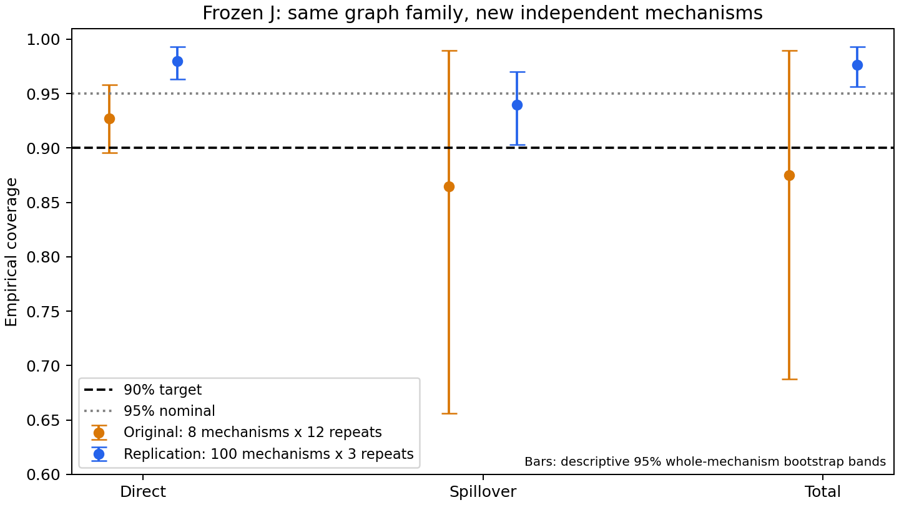
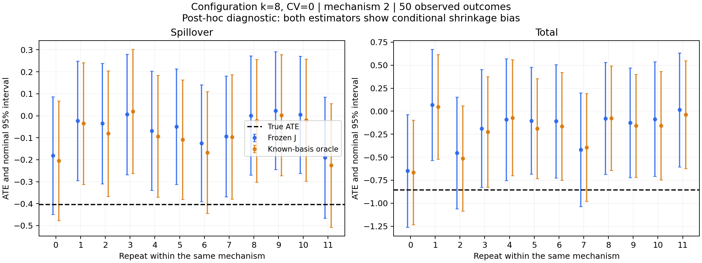

# E1.2 覆盖率证据补充与调整建议

日期：2026-10-28。状态：未提交、未推送、未创建 PR。本轮只补充证据，未调整冻结 J、DGP 或原 95% 区间。

后续进展：本文件保留证据补充阶段的原始结论；随后已完成独立校准与全配置测试，见 [新的实验结果](../e12_calibration_v1/README.md)。

结论：原实验的低覆盖集中在少数困难机制。真实特征 oracle 仍有同类失败；解析检查确认固定机制下的收缩偏差。另增 100 个独立机制后，原模型在被复查场景的覆盖率恢复到 94%–98%。因此，当前证据不足以支持直接按原 8 个机制统一放大区间，更不能据此断定 Configuration 图普遍不适用。建议先扩充独立机制验证，必要时用独立校准集调整区间，并将点估计偏差的改进另行评估。

## 已补齐的证据

| 项目 | 实际完成情况 | 文件 |
|---|---|---|
| 原始 notebook | 原源码 16 个代码单元全部执行，0 错误、8 个图像输出；原文件哈希未变 | `notebook/walkthrough_executed.ipynb`、`notebook/provenance.json` |
| 四状态 mu / ITE / ATE | 审核原 8,640 个支持 mu/ITE 的方法上下文；合并原 ATE 后共 120,960 条指标记录 | `metrics/task_metrics.csv`、`metrics/task_mean_sd.csv` |
| 任务间标准差 | 先在同一机制内汇总重复，再计算机制间 RMSE / bias 均值和样本 SD；同时保留 pooled RMSE | 同上 |
| 运行时间 | 原执行收据中的均值、中位数、P95、任务均值的 SD；J 区间计时单列 | `metrics/runtime.csv` |
| oracle | 48 个 Configuration 机制、1,728 个上下文，已知真实隐藏基函数、系数先验分布与噪声；只用已观测 Y 拟合 | `oracle/` |
| truth 复核 | 48 个机制的机制/truth 哈希吻合；每个机制独立穷举节点 0 的邻居处理，核对四状态真值 | `oracle/truth_checks.csv` |
| 原评测一致性 | 独立计算的 8,640 个 J 上下文×效应覆盖命中及误差与原 evaluator 一致；原数据哈希未变 | `metrics/provenance.json` |
| 新机制复查 | f103、观测数 50、机制 ID 1000–1099、每个 3 次重复，合计 300 个上下文 | `replication_metrics/` |
| 原制图制表脚本 | 新复查亦实际执行 `make_figures.py`、`make_table.py` | `replication_figures/`、`replication_tables/` |
| 测试 | 39 项通过，含 oracle 协方差和任务汇总检查 | `verification.json` |

HT 等原接口不提供 mu/ITE 时明确记录为不支持；不能填零或声称已比较这些方法的 ITE。诊断 oracle 也不是可部署基线，不替代负责 baseline 同学的文献核对。

## 覆盖率结果：原实验和新复查分开报告

固定场景：f103，N=200，平均度 8，CV=0，观测数 50；同一个冻结 J、同一个名义 95% 区间算法。

| 效应 | 原 8 个机制 × 12 次重复 | 新 100 个机制 × 3 次重复 | 新复查机制 bootstrap 95% 描述区间 |
|---|---:|---:|---:|
| 直接效应 | 89/96 = 92.71% | 294/300 = 98.00% | 96.33%–99.33% |
| 溢出效应 | 83/96 = 86.46% | 282/300 = 94.00% | 90.33%–97.00% |
| 总效应 | 84/96 = 87.50% | 293/300 = 97.67% | 95.67%–99.33% |

新复查预先固定了这 100 个 ID 和 3 次重复，没有反复更换种子寻找通过结果。它是在查看原结果后选择困难配置开展的定向诊断，不是预先注册的全配置最终测试。没有替换原 8 个机制，也没有合并数据掩盖失败。原 v1 的 54 个组合仍是 47 个达到 90%、7 个未达到；不能声称全部达标。



重复数据共享图、特征和系数，所以原 96 次不能视作 96 个独立机制。区间按机制整组重采样 10,000 次计算；尤其原来只有 8 个机制，bootstrap 仅作描述，不是精确保证。增加独立机制改善评测精度，本身不会改变某次估计的覆盖能力。

## 困难机制到底发生了什么

在原 f103、观测数 50 的溢出效应中，13 次漏覆盖全部是真值落在区间下方，其中 10 次来自机制 2。该机制 12 次重复的四个观测状态均非空；因此不能把这些失败简单归为某个状态没有数据。全局状态非空也不代表逐节点支持或信息充分。

| 机制 2 的溢出效应 | 冻结 J | 已知真实基函数 oracle |
|---|---:|---:|
| 真 ATE | −0.40448 | −0.40448 |
| 平均预测减真值（bias） | +0.34357 | +0.31855 |
| 重复间误差 SD | 0.07287 | 0.08027 |
| 平均区间半宽 | 0.27038 | 0.27809 |
| 覆盖重复数 | 2/12 | 3/12 |



oracle 使用正确的先验分布，仍会把有限数据下的系数向先验均值收缩；贝叶斯边际覆盖不保证对每个固定系数机制都达到 95%。这使“换成真实特征即可解决”这一解释缺乏支持；它也不排除模型失配在其他机制中起作用。

进一步对该机制的 12 个固定设计解析平均掉结果噪声，oracle 溢出 ATE 的平均条件偏差为 +0.28729，平均区间半宽为 0.27809，条件噪声 SD 为 0.07699，对噪声积分后的平均覆盖约 45.33%。因此不只是 12 次噪声偶然波动。解析诊断明确使用真系数解释偏差，结果仅写入 `oracle/shrinkage_f103_m2_observed50.csv`，没有输入 J 或用于拟合 oracle 的观测 Y 预测。

计算依据：令 F 为观测设计，Q 为先逐节点取对比、再在节点间平均的 ATE 设计，先验为 (mu,Sigma)，K=Sigma F' (F Sigma F'+sigma²I)^−1。固定真系数 beta 时，偏差为 Q(I−KF)(mu−beta)，采样协方差为 sigma² QKK'Q'。后验协方差为 Q(Sigma−KF Sigma)Q'。保留了共享系数导致的节点协方差，没有把各节点当作独立样本后错误除以 N。

## 点估计及运行时间补充

以下为原 f103、观测数 50 的溢出效应，表中“±”是 8 个机制的任务 RMSE 样本 SD，不是 RMSE 的置信区间。

| 方法 | ATE 任务 RMSE 均值 ± SD | ITE 任务 RMSE 均值 ± SD | ATE 平均有符号 bias |
|---|---:|---:|---:|
| J | 0.18313 ± 0.08577 | 0.19956 ± 0.07928 | +0.12007 |
| HT | 0.76363 ± 0.24925 | 原接口不支持 | +0.01622 |
| kernel-new | 0.18349 ± 0.07867 | 0.19955 ± 0.06955 | +0.07472 |
| 诊断 oracle | 0.17918 ± 0.08329 | 0.19353 ± 0.07433 | +0.11769 |

完整四状态和全部方法比较见 `comparison_f103_observed50.csv`。有符号 bias 可能跨机制抵消，不能替代绝对条件 bias；原 v1 表格仍保留条件 bias 和重复间方差。原全部 80 个机制、观测数 50 的平均点估计耗时：J 5.73 ms、HT 1.12 ms、kernel-new 28.05 ms；J 另需平均 6.34 ms 计算区间。计时不含模型加载、生成图或磁盘 IO，保留原方法运行顺序及缓存条件，不是冷启动性能结论。

## 应如何调整

1. **先扩大验证，不根据旧失败格直接调参。** 保留 v1 冻结结果。下一阶段为全部六种 Configuration 配置注册新的独立机制集合，至少包含校准与最终评测两组，按机制分离。已经查看的 v1 和本轮 100 个机制作为开发诊断资料，不再冒充未见最终测试。可采用每配置 100 个校准机制、200 个评测机制，预算仍为 20/50/100；数量是实用起点，不是达标保证。
2. **覆盖率的最小方法调整：独立的 ATE 区间校准。** 保留 J 点估计与原区间，另报一个清楚命名的校准版本。对每个配置×预算×效应，用独立校准机制的误差与原半宽计算分数 s=|真 ATE−区间中心|/半宽；以有限样本修正的 95% 分位数 q 构造“中心 ± max(1,q)×原半宽”。同一机制的所有重复不能直接当成独立校准样本；最简单可审查版本是每个校准机制只用预先指定的一次重复。K 个校准机制取第 ceil(0.95(K+1)) 个有序分数；若该下标超过 K，阈值应视为无穷，不能随意截成最大值。因此只有 8 个机制不足以支持这个标准的有限 95% 校准阈值。
3. **点估计偏差另做开发集消融。** 既然 oracle 也向先验收缩，可以在独立开发机制上比较当前先验与适度放宽的效应方向先验，或减弱相关正则化；选择同时依据 RMSE、绝对条件 bias、方差和区间宽度。放宽先验可能降低困难机制的 bias，也可能增加方差及总体 RMSE，不能预先保证改善。不要从一个机制的 +0.34357 出发给所有预测减同一常数，其他机制的偏差可能反向。
4. **最终同时报告代价。** 并排呈现冻结 J 与校准版本的覆盖率、平均区间宽度、点估计 RMSE/bias/variance、失败及支持数量，并按配置拆分。仅校准区间不改变点估计，所以 RMSE、bias、variance 应保持不变；这是预期行为。保持名义目标 95%，不要把 99% 后验区间重新称为 95%，也不要给潜在 ATE 随意加观测噪声。

以上分数校准是将 split conformal 应用于“独立模拟机制及其真 ATE”。其覆盖解释依赖校准机制与未来机制可交换，属于边际保证；不保证每个固定机制、任意结构 OOD，或某个有限测试批次都超过 90%。校准真 ATE 来自模拟器，因此也不能不加说明地推广到真 ATE 不可观测的真实数据。[方法依据：Angelopoulos 与 Bates，§1.1、§2.3](https://arxiv.org/html/2107.07511v6)

本轮没有实施上述校准或先验调整，也没有选出“最优扩宽倍数”。目前最优先的下一步是注册独立校准/测试协议，然后对区间校准做最小对照；如需改善点估计，再开展收缩强度消融。

## 可复现命令与边界

在 `iPFN_demo/code/sparse_j` 执行，每个输出目录需为空且不存在。原实验运行命令见 `../../E12_CONFIGURATION.md`。notebook 额外依赖 pandas、ipykernel、nbclient、nbformat；本机版本见 notebook provenance。

```sh
python verify_walkthrough.py --output results/e12_evidence/notebook
python audit_e12_evidence.py --input runs/e12_v1 --output results/e12_evidence/metrics
python diagnose_e12_oracle.py --input runs/e12_v1 --output results/e12_evidence/oracle
python diagnose_e12_shrinkage.py --input runs/e12_v1 --output results/e12_evidence/oracle/shrinkage_f103_m2_observed50.csv
python verify_e12_new_mechanisms.py --output runs/e12_replication_v1
python audit_e12_evidence.py --input runs/e12_replication_v1 --output results/e12_evidence/replication_metrics
python make_table.py --input runs/e12_replication_v1 --output results/e12_evidence/replication_tables
python make_figures.py --input runs/e12_replication_v1 --output results/e12_evidence/replication_figures --observed 50
python report_e12_evidence.py --input results/e12_evidence
python -m pytest -q
```

数值记录压缩在 `evidence_records.zip`，展开即得到对应 CSV 和本轮复查执行清单；大数组保留在本地忽略的 `runs/` 与 `oracle/predictions/`。notebook 的运行时连接文件不纳入交付。

老师要求中的逐节点经验支持诊断、完整结构/机制 OOD 矩阵、所有 baseline 文献适配和统一接口最终验收仍有待后续协作；本轮没有把这些未完成项标记为完成。
