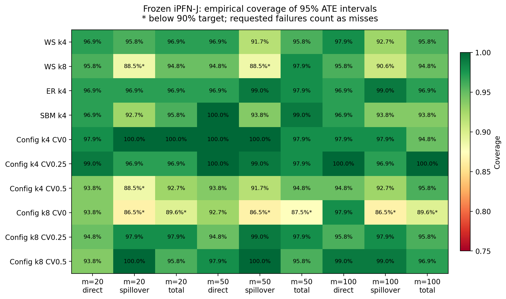
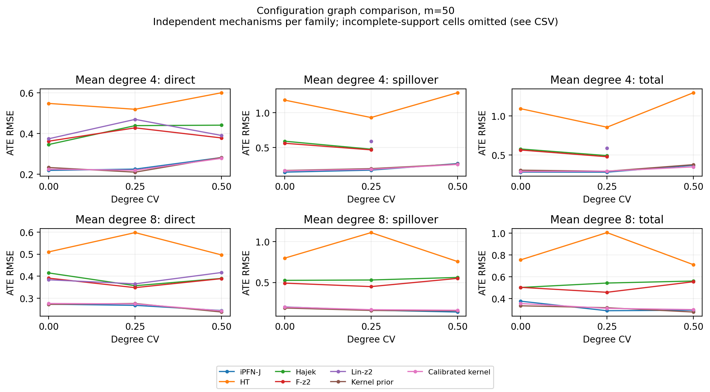

# E1.2 实验审阅

状态：代码与实验已完成本轮验证，**尚未提交、未推送、未创建 PR，等待用户审阅**。

## 本次实现

- 新增 6 个 Configuration 配置：平均度 4/8 × 度 CV 0/0.25/0.5。
- 度序列先通过图形性检验，再以 Havel–Hakimi、保度分量连接和有限次连通换边生成无向、无自环、无重边、连通图。
- 这是有限换边的固定度 Configuration 变体，不宣称精确均匀抽样；当前采用两点度分布，不是幂律度分布。
- 新配置追加为 base ID 8–13，使用独立家族 ID 100–105；原图生成分支、原家族、种子、DGP、truth、冻结模型、方法名称和区间算法保留。
- 新入口 `benchmark_e12.py` 复用原 benchmark 执行流程；每张图记录实际度统计、度向量和哈希。

具体算法及复现命令见 [E12_CONFIGURATION.md](../../E12_CONFIGURATION.md)。

## 运行规模与验证

6 个 Configuration 配置 + 4 个旧图对照；每个配置 8 个机制、12 次处理/噪声重复，观测预算 20/50/100。
共 80 个机制、2,880 个数据上下文、20,160 次方法评测，比较 iPFN-J、HT、Hajek、F-z2、Lin-z2、旧核与校准核。

- 34 项测试通过；测试包含 N=50/100/200 的生成器性质、非法/非图形度序列、随机复现及实际 J/HT 推断。
- 80 张图均连通；48 张 Configuration 图的实际平均度和 CV 全部精确符合注册值。
- 没有预测异常或区间计算异常。部分基线的效应支持掩码为 false，这与执行异常不同，详见 CSV 的支持数量。
- 七个原家族的机制/truth 哈希及 21 个观测上下文哈希逐一保持一致；原 `j ht` 冒烟命令的预测、区间、评测数组也保持一致。
- `make_table.py` 和 `make_figures.py` 已实际运行；另提供按图配置拆分的报告。

## 覆盖率：目标尚未全部达到

名义 95% ATE 区间仅由原接口中的 iPFN-J 支持。对 Configuration 图逐项检查后，
54 个“配置 × 观测预算 × 效应”组合中 **47 个达到 90%，7 个未达到**。
最低覆盖率为 **86.46%**。没有利用这些评测结果重新调节区间或修改测试集。

| 配置 | 观测数 | 效应 | 覆盖率 |
|---|---:|---|---:|
| k4，CV=0.5 | 20 | spillover | 88.54% |
| k8，CV=0 | 20 | spillover | 86.46% |
| k8，CV=0 | 20 | total | 89.58% |
| k8，CV=0 | 50 | spillover | 86.46% |
| k8，CV=0 | 50 | total | 87.50% |
| k8，CV=0 | 100 | spillover | 86.46% |
| k8，CV=0 | 100 | total | 89.58% |

每个组合有 96 次重复结果，但只有 8 个独立机制。CSV 给出了以机制聚类计算的覆盖率 Monte Carlo 标准误；重复不能视为 96 个独立机制。
对照 WS k8 在 m=20/50 的 spillover 也低于目标。下一轮应在独立开发机制上诊断/校准并用新注册的评测机制验证，而非在本批结果上调至达标。

## m=50：六个 Configuration 配置的汇总

以下 J 的 RMSE、平均绝对条件偏差和机制内样本方差来自既有 `make_table.py` 计算定义。
“绝对条件偏差”是各机制内平均误差的绝对值再求平均，并非 pooled signed bias；后者也保存在 `by_family.csv`。

| 效应 | J RMSE | J 绝对条件偏差 | J 方差 | J 覆盖率 | HT RMSE |
|---|---:|---:|---:|---:|---:|
| direct | 0.2529 | 0.1209 | 0.04642 | 96.53% | 0.5468 |
| spillover | 0.1851 | 0.1270 | 0.01130 | 96.01% | 1.0305 |
| total | 0.3162 | 0.1474 | 0.06613 | 95.31% | 0.9751 |

J 的汇总误差低于 HT；与两种核方法很接近，校准核的 total RMSE 为 0.3155，不能称 J 在所有指标上都最好。
汇总覆盖率均超过 90% 不代表每个配置都达标，上表不能代替逐配置检查。
不同家族使用独立机制，当前结果也不能被解释为“只改变图的因果对照实验”，或度异质性存在单调性能效应的证据。

## 文件

- `family_report/by_family.csv`：每配置/方法/预算/效应的 RMSE、偏差、方差、覆盖率、聚类标准误和支持计数。
- `family_report/configuration_pooled_m*.csv`：仅六个 Configuration 配置的汇总；不完整支持不参与完整排名。
- `tables/`：原 `make_table.py` 生成的全实验 CSV/LaTeX 表格。
- `figures/`：原 `make_figures.py` 生成的 m=50 全实验图与源数据。
- `graph_statistics.json`：80 张图的真实度统计、度向量、图/机制/truth 哈希。
- `run_manifest.json`：运行配置、版本、模型哈希和支持摘要。
- `evaluation_records.zip`：完整 execution receipts 与各层级评测 CSV。解压后可再次运行 make_table、make_figures、report_e12。
- `validation.json`、`legacy_hashes.json`：验证记录、源文件指纹和旧实验兼容性证据。

原始 factual/truth/predictions 保留在本地 `runs/e12_v1/`（约 184 MiB），未纳入拟提交文件。
从原始预测重新执行 `evaluate.py` 需要该目录；仅从误差记录重绘图表可使用上面的压缩包。
